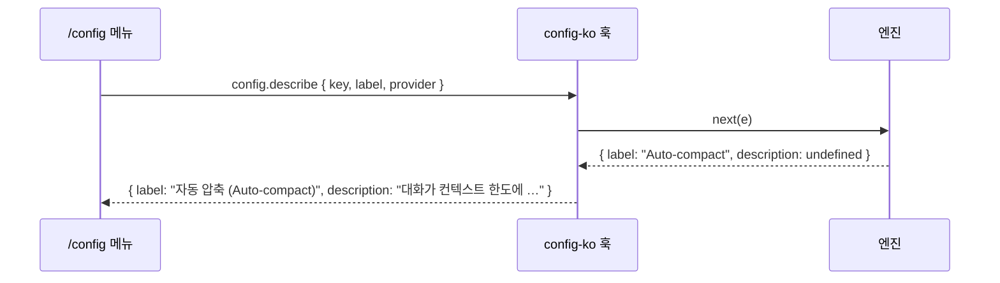

# claude-config-ko — PLAN

## 목차

1. 새 세션에서 시작하는 순서
2. 구조
3. 단계
4. 확인 방법
5. 새 엔진 버전이 나왔을 때

## 1. 새 세션에서 시작하는 순서

1. `docs/PRD.md`의 요구사항(R-N)과 결정 사항을 읽는다.
2. 모드 코드를 고치기 전에 `plugin-authoring` 스킬을 불러온다(그 빌드의 API 선언이 딸려 온다).
3. 고친 뒤 4절의 확인을 모두 돌린다.
4. 커밋은 레포 안 `git config`의 `JunH-K`로 한다(이 맥의 전역 git 사용자는 회사 계정이다). push할 때 gh 활성 계정이 회사 계정이면 그 명령에만 `GH_TOKEN=$(gh auth token --user JunH-K)`를 쓴다.

## 2. 구조

```
claude-config-ko/
├── .claude-plugin/
│   ├── plugin.json        # 모드 이름 config-ko, 버전
│   ├── marketplace.json   # 레포 자체가 설치 출처(마켓플레이스 이름 claude-config-ko)
│   └── types/             # 엔진이 불러올 때 깔아 주는 타입 선언(git 무시)
├── hooks/
│   ├── hooks.json         # { "modules": ["./register.tsx"] }
│   ├── register.tsx       # 훅 5개: config.describe, session.start, command.run, config.set, ui.render(창 그리기). 엔진을 아는 유일한 파일
│   ├── table.ts           # 줄 키 → { ko, desc } 표(60개)와 relabel() 순수 함수
│   └── help.ts            # 도움말 창의 값 글자 valueText() 순수 함수
├── tests/
│   ├── table.test.ts      # relabel()과 표 검사 (8개)
│   ├── help.test.tsx      # valueText(), 창 그리기, /config-ko 명령 (3개)
│   └── fixture.ts         # 2026-10-21 집 맥에서 실제로 뽑은 42개 줄(키, 영어 이름)
├── docs/PRD.md, docs/PLAN.md
├── README.md              # 하는 일, 안 되는 것, 설치·끄기
├── CLAUDE.md              # 이 레포에서 일하는 규칙
└── tsconfig.json          # .claude-plugin/types/tsconfig.json 을 이어받음
```

### 이름 바꾸기 (R-1~R-5)



- `relabel(key, isEngine, base)`: `isEngine`은 `e.provider.plugin === 'engine'`이다. 엔진 줄이 아니거나 표에 없는 키면 `base`를 그대로 돌려준다(R-4). 있으면 `label = "${ko} (${base.label})"`, `description = base.description ?? desc`(R-1, R-2). `isHidden` 등 나머지는 그대로다(R-5).
- `base.label`이 이미 `"${ko} ("`로 시작하면 다시 붙이지 않는다(R-1).

### 도움말 창 (R-9)

- `session.start`: 대화형 세션(`e.isInteractive`)에서만 `/config-ko`를 등록한다.
- `command.run`(`config-ko`): `$.ui.open({ id: 'config-ko', title: '설정 도움말' })`. 놓였는지(`isPlaced`)에 따라 알림 글을 고른다. 이 글은 모델도 읽으므로 짧게 둔다.
- `ui.render`(Pane, `config-ko`): 그릴 때마다 `$.config.list()`를 읽는다. 그 결과에는 이 모드가 바꾼 이름·설명이 이미 들어 있으므로 표를 다시 읽지 않는다. 상태(`$.state`)를 따로 두지 않는다. 줄마다 `이름(굵게)  값  (잠김)` 한 줄과 흐린 설명 한 줄을 그린다.
- `config.set`: `next(e)` 뒤에 `$.ui.invalidate('ui.render')`로 창을 다시 그린다. 값 바꾸기에는 끼어들지 않고, 실패해도 `.catch`가 그대로 넘긴다(R-8).

## 3. 단계

| 단계 | 내용 | 상태 |
| --- | --- | --- |
| 1 | PRD·PLAN 작성 | 완료 |
| 2 | `table.ts`(60개 키) + 훅 작성 | 완료 |
| 3 | 테스트 작성, validate·test·tsc 통과 | 완료(11개 통과) |
| 4 | `claude -p --plugin-dir .`로 `$.config.list()`가 한국어 이름을 돌려주는지 확인 | 완료(42줄 모두) |
| 5 | tmux 실제 세션에서 `/config` 화면 확인(이름·설명·검색) | 완료. 이름·검색은 됨, 엔진 줄 설명은 메뉴가 그리지 않음 → 5a |
| 5a | `/config-ko` 도움말 창(R-9) 구현·테스트·tmux 확인 | 완료(창 표시, `/config`에서 값 바꾸면 창 갱신) |
| 5b | 설명을 이름에 덧붙이는 안 실험 → 사용자가 지금 모양 유지로 결정 | 완료 2026-10-21 |
| 6 | 비밀 검사 후 공개 레포 `JunH-K/claude-config-ko` 생성·push | 완료 2026-10-21 |
| 7 | 이 맥에 사용자 범위로 설치, 새 세션에서 `/config`·`/config-ko`·영어 검색 확인 | 완료 2026-10-21 (GitHub 출처, 0.1.0) |
| 8 | 회사 맥: README의 설치 한 줄, 새 세션에서 `/config` 확인 | 회사 맥에서 |

## 4. 확인 방법

- `claude plugin validate .` — 매니페스트·마켓플레이스·모듈을 엔진처럼 읽는다. README가 없으면 디렉터리 검사가 막는다.
- `claude plugin test .` — `tests/*.test.ts(x)`.
- `tsc -p .` — 타입 검사. `.claude-plugin/types/`는 엔진이 이 폴더를 `--plugin-dir`로 한 번 불러와야 생긴다. 없으면 `claude --plugin-dir .`로 세션을 한 번 열거나, 엔진 타입 파일 머리말의 tsconfig를 폴더 밖에 두고 돌린다.
- 실제 목록: `$.config.list()`를 파일로 쓰는 임시 모드를 함께 `--plugin-dir`로 넣고 `claude -p`를 돌려 이름이 바뀌었는지 본다.
- 실제 화면(tmux): 이 맥은 "에이전트 화면을 기본으로 열기"가 켜져 있어 그냥 `claude`를 띄우면 에이전트 화면이 열리고, 거기 친 글은 **새 세션으로 만들어진다**. `claude '/config'`처럼 첫 입력을 인자로 줘서 띄운다. 처음 여는 폴더는 신뢰 질문이 뜨므로 이미 신뢰한 폴더에서 띄운다. 메뉴 안에서 Esc를 두 번 누르면 되감기(Rewind) 화면이 열린다.
- 설치본 확인: `claude plugin list`에 `config-ko@claude-config-ko`가 `enabled`. 이미 열려 있던 세션은 `/reload-plugins`.

## 5. 새 엔진 버전이 나왔을 때

새 줄은 영어로 남는다(R-4). 표를 늘리는 순서:

1. 엔진 바이너리(`~/.local/share/claude/versions/<버전>`)를 `strings`로 풀어, 설정 패널의 `{id:"…",label:…}` 정의를 뽑는다(`id`가 줄 키다).
2. 표에 없는 키를 찾는다.
3. 그 줄이 쓰는 설정 이름의 스키마 `.describe("…")` 문구와 패널 코드를 읽고 설명을 쓴다.
4. `tests/fixture.ts`를 새로 뽑은 목록으로 바꾸고 4절의 확인을 돌린다.
5. 버전을 올리고(`plugin.json`) push한 뒤 각 맥에서 `claude plugin update config-ko@claude-config-ko`, 열린 세션은 `/reload-plugins`.
